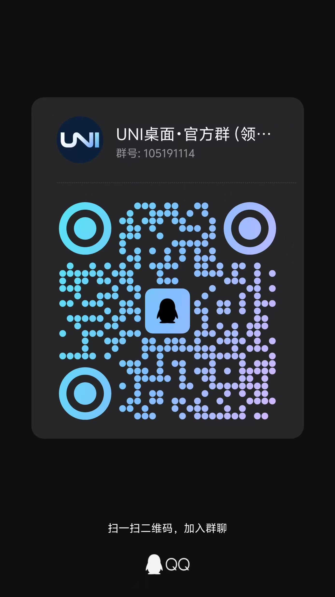

# UNI桌面

面向领克 05 系列原车 IP753 车机的 Android 桌面（理论上其他车型也可能适用）。界面使用 Flutter 构建，通过 Android 原生适配层接入导航、媒体和车辆信息；应用包名为 `xyz.i4o.uni.launcher`。

## 功能

- 卡片式桌面：支持分页、拖动、缩放和布局保存，提供导航、音乐、天气、车辆信息等卡片。
- 外观：提供深浅色、深蓝玻璃主题、自定义主题色、圆角和壁纸设置。
- 导航与媒体：支持关联导航和音乐应用，显示歌词及真实音频频谱；全局底栏提供媒体和车辆相关操作。
- 车辆接入：参考原车 Launcher 的接口读取和控制支持的车辆功能，具体能力以车机权限和实车验证结果为准。

红绿灯卡片支持已核对的高德广播；百度、腾讯地图的多方向数据出口仍在研究。各项能力和验证边界详见[更新日志](CHANGELOG.md)及[红绿灯接入记录](docs/TRAFFIC_LIGHT_PROVIDERS.md)。

## 支持车型

| 车型 | 年份 | 车机系统版本 | 支持情况 | 备注 |
| --- | --- | --- | --- | --- |
| 领克 05 PHEV | 2021 年 | 753（IP753） | ✅ | 主功能均可用 |
| 领克 05 劲 Halo | 2020 年 | 753（IP753） | ✅ | 除胎压显示异常外，主功能均可用 |
| 领克 06 燃油版 | 2023 年 | E02 | ✅ | 主功能均可用 |

欢迎在 Issue 中反馈其他车型的支持情况，请注明车型、年份、车机系统版本和测试结果，以便同步更新本清单。

## 运行环境

- 已验证的车型和车机版本见上表；未列出的车型或车机版本的兼容性尚未验证。
- 开发环境：Flutter、Android SDK、Java 17；Android 最低 API 24。已验证的工具链及详细配置见 [Flutter 工程说明](app/README.md)。
- 应用当前版本以 [pubspec.yaml](app/pubspec.yaml) 为准。模拟器验证不能替代车机功能和性能验证。

## 获取与构建

在仓库根目录执行：

```sh
cd app
flutter pub get
flutter analyze
flutter test
flutter build apk --release --target-platform android-arm64,android-x64 --split-per-abi
```

构建产物位于 `app/build/app/outputs/flutter-apk/`：arm64 包用于 ARM 设备，x86_64 包用于模拟器。普通构建使用本地开发签名；IP753 测试包使用单独签名，同签名的版本才能覆盖安装。签名文件不包含在仓库中。构建和签名细节见 [Flutter 工程说明](app/README.md) 与对应[版本记录](CHANGELOG.md)。

### 发布安装包

安装 [GitHub CLI](https://cli.github.com/) 并执行 `gh auth login`。将对应源码提交推送到 GitHub，确认本地 IP753 APK 由该提交构建并已正确签名，然后在仓库根目录执行：

```sh
python3 tools/upload_release.py --dry-run  # 检查版本、文件和 SHA-256
python3 tools/upload_release.py            # 上传 APK 并创建 Release 草稿
```

脚本从 `pubspec.yaml` 读取版本，从更新日志提取相应内容，上传 APK 和 SHA-256 校验文件；不会自动推送代码或上传签名文件。可用 `--apk 路径` 指定其他 APK，`--prerelease` 标记预发布。草稿请在 GitHub 上检查后发布；脚本无法验证 APK 与源码提交的对应关系。

## 使用

在全部应用中点击“UNI桌面设置”，或长按首页进入桌面设置；长按卡片可调整桌面布局。快捷应用卡片可选择并管理常用应用，音乐卡片支持切换已识别的播放器。导航应用、播放器和底栏选项可在桌面设置中配置。部分车辆、地图及频谱功能依赖相应系统权限、应用支持和设备能力。

## 项目结构

| 目录 | 内容 |
| --- | --- |
| `app/` | Flutter 界面、Android 应用入口和测试 |
| `app/android/` | Android 平台入口、原生适配和导航栏资源 |
| `app/native-tests/` | 原生适配测试、模拟器夹具和测试工具 |
| `archive/webview-android/` | 早期 WebView 基线与历史验证资料 |
| `docs/` | 设计、接口、版本验证与实车记录 |
| `design/` | 设计稿及交互原型 |
| `analysis/` | APK 分析摘要与证据索引 |
| `tools/` | 分析、构建与验证辅助工具 |

## 文档

- [更新日志](CHANGELOG.md)与[实车验收记录](docs/CAR_ACCEPTANCE.md)
- [Flutter 工程说明](app/README.md)与[原车车辆接口](docs/OFFICIAL_CAR_API.md)
- [导航与红绿灯](docs/AMAP_TRAFFIC_LIGHT_CARD.md)、[媒体歌词与动效](docs/MEDIA_LYRICS_AND_MOTION.md)
- [产品与界面设计](docs/PRODUCT_DESIGN.md)、[车辆卡片设计](docs/VEHICLE_CARD_DESIGN.md)
- [项目目录与原生代码](docs/PROJECT_STRUCTURE.md)、[完整参考资料与历史设计](docs/PROJECT_REFERENCE.md)

## 交流与反馈

欢迎加入 UNI桌面 QQ 交流群，交流使用体验与车型适配：**105191114**。可使用 QQ 扫描下方二维码加入；问题和功能建议也欢迎通过仓库 Issue 反馈。



## 贡献与 Pull Request

永远欢迎提交 Pull Request！请使用 `feat/lynkco-<车型>` 命名车型功能分支，例如领克 05 使用 `feat/lynkco-05`。

提交 PR 前，请在对应车型的车机上完成测试并确认验证通过，在 PR 描述中说明车型、车机系统版本及测试结果。同时请同步最新的 `main` 分支，解决所有合并冲突，确保 PR 可以无冲突地合并到 `main`。

## 免费使用与许可声明

UNI桌面免费提供，其原创代码及资源采用**非商业、源码可用、相同条款共享**的自定义许可：禁止未经授权的商业使用和收费，分发时须向接收者提供对应源码，并按相同条款共享。完整条款见 [LICENSE](LICENSE)。

由于本许可限制商业使用，它不符合开放源代码促进会（OSI）的开源定义，不属于 OSI 认证的开源许可证。第三方内容仍遵循各自的许可。
