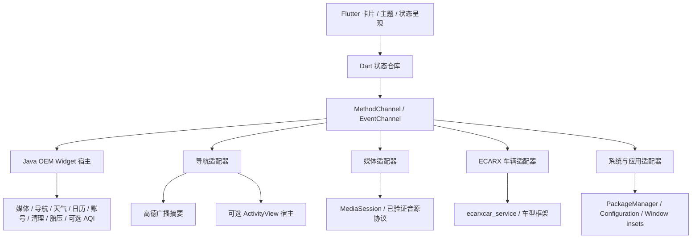

# 接入架构与实施计划

本文件保留接入规划；当前实现为 Flutter Android，包名 `xyz.i4o.uni.launcher`。已实现范围见 [Flutter README](../app/README.md)，实车协议和字段一致性仍待设备验证。一个 Launcher APK 内部模块化，沿用官方宿主与原厂来源。

## 1. 架构



当前采用 Flutter 渲染层和 Java 集成适配器，卡片、设置、底栏和主题均由 Dart Widget 构建，不载入 WebView。`app/` 的 Android 工程直接编译 `app/android/app/src/main/java/xyz/i4o/uni/launcher/` 下的 `integration` 与 `core`，原厂 Provider 目录仍仅有一份。平台通道交换状态与限定动作；原厂 Widget 兼容页保留 Android View。

毛玻璃是独立外观开关，默认关闭；关闭时不创建 `BackdropFilter`，保留半透明材质，开启时按卡片边界裁切模糊。性能指标仍为实车验收目标：暖回桌面 300ms 内出现主界面、稳定后避免高频轮询；冷启动、帧率、PSS 在 IP753 上实测，不能以模拟器代替。

## 2. 接口契约

```text
Capability
  id, source, supported, readable, writable
  reason, unit, min?, max?, step?, enumValues?, lastProbeAt

ObservedValue<T>
  value?, source, status(ready/stale/unavailable/disconnected)
  receivedAtElapsedRealtime, sequence, rawValue?

Command<T>
  id, capabilityId, desiredValue, submittedAt, timeoutMs
  phase(submitted/accepted/confirmed/failed/timedOut)
  actualValue?, error?
```

设置页可以查看来源和接入状态；普通驾驶界面只显示“未连接”“暂不可用”“未生效”等能指导用户的说明。UI 不感知 Binder、属性 ID、系统 UID 或异常堆栈。

私有车身框架以 `compileOnly` stub 建立编译边界，运行时加载设备已有实现；stub 从本车框架签名/方法清单生成，保留出处。仅匹配测试证书或写共享 UID 不能代替权限探测；构建使用本地外置签名材料，仓库不保存私钥。桌面包名独立于官方和嘟嘟。

## 3. 功能与降级矩阵

| 功能 | 主路径 | 兼容路径 | 尚需核实 | 优先级 |
| --- | --- | --- | --- | --- |
| HOME / 应用列表 | MAIN+HOME、PackageManager、应用变化回调 | 保留原桌面/官方应用面板入口 | 默认桌面选择、系统返回行为 | P0 |
| 原车底栏 | 按实际窗口 Insets 保留原车区域 | 普通应用窗口模式 | 窗口所有者、层级、触控边界 | P0 |
| 官方 Widget | AppWidgetHost + 枚举 Provider + 合法绑定 | 直接打开提供者应用 | DCY11 列出的 Provider 是否安装、权限、尺寸 | P0 |
| 音乐 | 与官方媒体中心同源的已验证数据/操作 | 经过同值比对的 MediaSession / 官方媒体 Widget | 当前音源、字段、控制 actions 与官方卡片一致 | P1 |
| 导航摘要 | 与原车导航服务同源的字段映射 | 高德广播经比对后适配 / 官方 Widget / 启动导航 | 路线、字段、单位、无效与停止导航状态 | P1 |
| 日历 / 账号 / 清理 | 各官方 Provider 应用已验证接口 | 原厂 Widget 或打开原车应用 | 完整字段、权限、动作、错误/空值、账号上下文 | P1–P2 |
| 天气 / 空气质量 | 官方天气 / HVAC AQI 来源 | 原厂 Widget 或原车应用 | 城市、字段、单位、更新时间；AQI 按 PM2.5 能力启用 | P1–P2 |
| 深浅主题 | Configuration.uiMode + 手动选择 | ECARX 亮暗信号经验证后补充 | 变化来源、枚举、Widget 自身配色 | P1 |
| 空调 | ECarXCarClimateManager，读状态后允许写 | 打开原车空调面板 | 本车框架、授权、范围、命令回读与超时 | P2 |
| 胎压 | ECarXCarVfmiscManager，只读 | 原厂胎压 Widget / 车辆应用 | 单位、有效值、四轮顺序、唤醒时机 | P2 |
| 完整导航嵌入 | 单个 ActivityView 容器 | 始终可回退导航摘要/全屏应用 | Android 9 隐藏 API、resize、触摸、焦点、休眠恢复 | P3 |
| 电话 / 语音 / 摄像头 | 打开本车已解析的官方入口 | 维持系统原有入口与接管 | 实际 exported Activity / Intent / 系统策略 | P2–P3 |
| PHEV 电量 / 续航 | 待发现明确的只读接口 | 暂不显示 | 不将其他车型属性 ID 当作本车接口 | P4 |

Android 9 对 OEM Widget 的样式控制有限，不能使用 Android 12 才引入的 `AppWidgetHostView.setColorResources`，也不能假定宿主能随意重绘第三方 RemoteViews。设计中的统一音乐/导航卡片由各自数据适配器驱动；兼容部件可保留原厂视觉。

V04 用户要求统一新样式并保留官方信息。以 `analysis/official-widgets.json` 为覆盖清单，建立 `OfficialCardAdapter`：保留 Provider/版本、原始字段、单位/精度/枚举、空值/失效/过期语义、时间戳和点击动作，只改变布局和视觉 token。没有经过同值比对的第三方天气、系统内存读数、媒体通知或其他车型属性不能替代原车字段。

当前缺 Provider APK 和实车观测，适配器仍为规划。后续验收逐卡记录：官方原图/布局 → 字段与状态清单 → 来源与权限 → 新 UI 同值快照 → 操作结果及回调。覆盖类型与数据一致性是分开的验收项，不能因样式已画齐就标记实时字段通过。

## 4. 各适配器的实现要点

**WidgetHostAdapter**：固定自己的 hostId，持久化实例 ID、Provider、尺寸和用户；`bindAppWidgetIdIfAllowed` 不允许时走系统绑定授权；配对 `startListening/stopListening`，处理 Provider 升级/删除和宿主重建。官方定向 `MediaUpdate` 只是候选兼容操作，需核对接收方清单再调用。宿主不写官方 Launcher 数据库。

**NavigationAdapter**：严格区分 SEND 接收与 RECV 控制；字段类型、米/秒单位、枚举、缺失值逐项验证。当前道路、导航转向和导航速度分别有来源标记，不将导航广播的 `CUR_SPEED` 当作已核实的车辆 CAN 车速。外来广播校验范围、最大文本/JSON 长度，防止异常内容阻塞首页。先展示和打开导航，再实现目的地动作；原型中“回家/公司”只是本地示例场景。

**MediaAdapter**：与原车媒体中心的音源选择、metadata、playbackState 和 actions 保持一致；若标准会话经实测同值，可作为数据通道。导航播报、通话焦点由原车音频体系处理，不能把收到的任意活动会话当作原车当前音源。通知监听权限通过用户/系统授权获得，不把清单声明当作已授权。

**VehicleAdapter**：连接 `ecarxcar_service`，按车型找到具体管理器；首次只读枚举支持项、初始状态和回调。保存每个 capability 的范围和编码，包括样本中温度 x2；命令按同一目标串行、限频，并以回调确认。服务断开时取消待确认命令、置灰控制，重连后重新读状态，不重放过期车控。胎压仅在单位/有效值确认后转换。

**ThemeAdapter**：保存 auto/light/dark 偏好，系统配置变化更新 UI；手动主题不被状态回调覆盖。原地图/系统栏和 Widget 的主题分别确认，不承诺一键使所有第三方界面同色。

**SystemAdapter / AppRepository**：应用列表订阅安装/删除/改名，缓存图标并处理横屏资源；快捷入口用解析后的 ComponentName + package signature/version 记录。原车设置、车辆、电话、导航和原桌面入口首期保持可达。桌面休眠/恢复不反复启动外部应用。

## 5. 实施里程碑与验收

| 阶段 | 产出 | 完成条件 |
| --- | --- | --- |
| M0：本次交付 | V04 七类默认 / 九类总览、14 组件映射、指定顺序底栏、长按设置、自由卡片与全部面板、Git | 设计交互与导出完成；验证结果入库；字段一致性明确待确认 |
| M1：车机基线 | 只读探测工具输出：包/权限/Widget/窗口/服务/框架方法 | 确认本车 Launcher 版本和底栏归属；清单中每项标实际可用性 |
| M2：原生 MVP | HOME、应用抽屉、深浅主题、媒体/导航摘要、兼容 Widget | 车机重启/休眠恢复可回桌面；实际音乐和引导可更新；底栏可操作 |
| M3：座舱整合 | 空调、胎压、数据状态与恢复 | 先完成只读对比，再逐项验证正常可逆的空调操作及回读 |
| M4：导航容器 | ActivityView 能力验证和可选启用 | 全屏切换、触摸、音频、返回、倒车接管和重连均可恢复；失败回摘要 |
| M5：打磨 | 字号/触控/亮暗/性能/长期恢复 | 明确内存与启动实测结果，清理高频刷新和多余进程 |

不设未经实际排期依据的天数。实施依赖“设备侧数据和权限已核实”，每一阶段保留完整可工作的回退路径。

## 6. 下一次上车需要采集的内容

这是为解决接口未知项的工作清单，不要求用户现在操作车辆：

1. `wm size`、`wm density`、`dumpsys window`：实际分辨率、Insets、底部常驻区所有者与应用可用区域。
2. `dumpsys package ecarx.launcher3` 与相关应用清单：当前版本、签名、权限、可启动组件；与样本 SHA/版本比对。
3. `dumpsys appwidget`：安装的导航/媒体/胎压 Provider、宿主和绑定约束。
4. `service list`、所需 framework JAR 的只读方法清单：确认 `ecarxcar_service`、适配 API、ActivityView 的实际签名。
5. `dumpsys media_session`：音乐播放/暂停/切源时是否存在有效会话，支持哪些控制动作。
6. 定向记录高德导航广播与 ECARX 回调的字段、单位、有效值、频率；不收集账号凭据和真实家庭地址。
7. 初始只读比较原车界面，之后逐项验证温度/风量等受控操作及回读；不批量重放未知命令。

这些采集结果用于把 `candidate` 提升为 `verified`，不把静态代码证据直接写成“本车已支持”。

## 7. 外部依据

- [Android MediaSessionManager](https://developer.android.com/reference/android/media/session/MediaSessionManager)：活动会话与权限，采用 API 21 已有的 `getActiveSessions`，不依赖新系统方法。
- [Android Widget Host](https://developer.android.com/develop/ui/views/appwidgets/host)：宿主 ID、绑定、生命周期及不同 API 的能力。ECARX 车控与高德具体字段由本地 APK 证据定位；实装按设备/应用版本核实。
